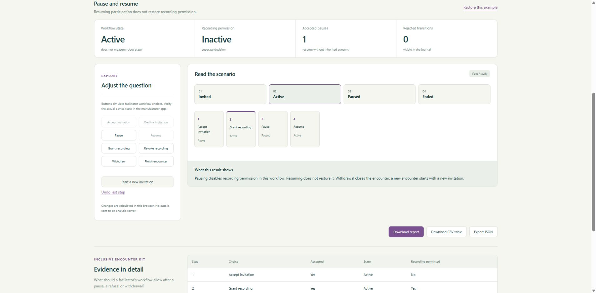
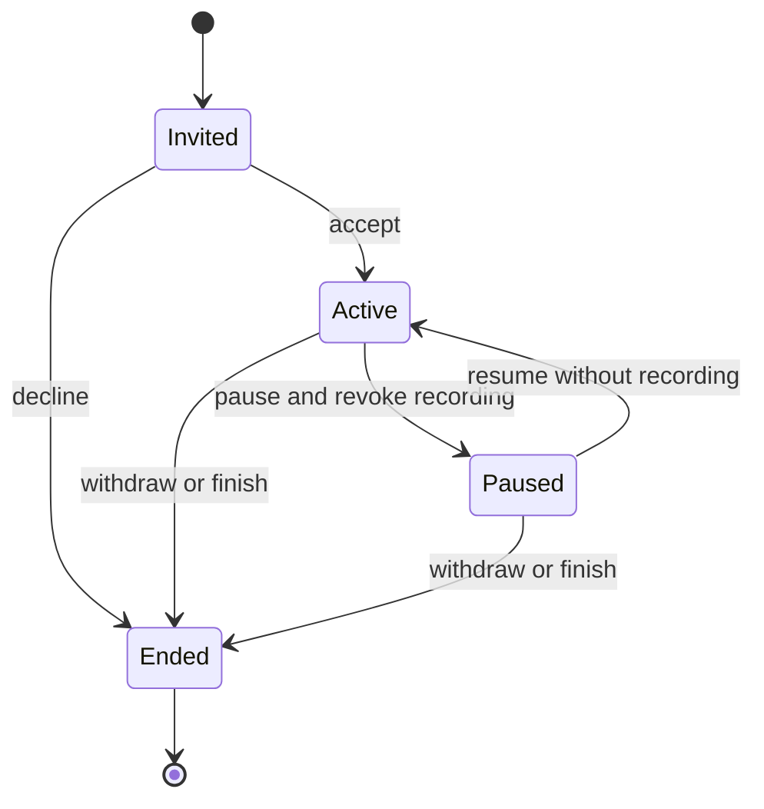

<p align="center"></p>

<h1 align="center">Inclusive Encounter Kit</h1>

<p align="center"><strong>An invitation. Always a choice.</strong><br>Um convite. Sempre uma escolha.</p>

<p align="center">
<a href="https://github.com/galafis/vbot-inclusive-encounter-kit/actions/workflows/checks.yml"></a>


</p>

<p align="center"><a href="https://galafis.github.io/vbot-inclusive-encounter-kit/?lang=en"><strong>Open the interactive study</strong></a> · <a href="https://galafis.github.io/vbot-inclusive-encounter-kit/?lang=pt"><strong>Abrir estudo em português</strong></a> · <a href="docs/DEMO.md">Guided walkthrough</a> · <a href="docs/EXPERIMENTS.md">Reproduce the examples</a></p>

[](https://galafis.github.io/vbot-inclusive-encounter-kit/?lang=en&example=pause-and-resume)

[English](#english) · [Português](#português)

## English

Rehearse a voluntary robot encounter. Participation, pauses, withdrawal and recording permissions remain separate and visible.

**Research question:** What should a facilitator's workflow allow after a pause, a refusal or withdrawal?

This is a working, independent software study for a proposed Vbot companion-robotics program. You can run every example without a robot, account, package installation or API key. Physical validation has not been performed.

### Explore in one minute

1. [Open **Pause and resume**](https://galafis.github.io/vbot-inclusive-encounter-kit/?lang=en&example=pause-and-resume).
2. Inspect the chart and the explanation below it. The starting result is **active · recording: false · 0 rejected**.
3. Adjust a control or select a contrasting example. Download a printable HTML report, a CSV evidence table or the full JSON analysis.

[View a portable example report](https://galafis.github.io/vbot-inclusive-encounter-kit/examples/sample-report.html).

The JSON editor is available under **Advanced**; the main study uses guided controls.

### What you can investigate

- Separate participation and recording choices, with a finite state machine.
- Interactive choice buttons constrained by the workflow's current state.
- Pause removes recording permission; resume does not inherit it.
- Withdrawal is final for the session; a new invitation starts a new encounter.
- A minimal journal and recording sequence windows without free-text input disclosure.

All five studies include a responsive English/Portuguese interface, keyboard focus styles, synthetic narrated examples and local report exports. Analysis runs in your browser after the page loads.

### Five examples, five questions

| Example                                                                                                                      | Question it exposes                                                       | Reproducible core result               |
| ---------------------------------------------------------------------------------------------------------------------------- | ------------------------------------------------------------------------- | -------------------------------------- |
| [Encounter with withdrawal](https://galafis.github.io/vbot-inclusive-encounter-kit/?lang=en&example=baseline)                | Permissions change during an encounter ended by choice.                   | ended · recording: false · 0 rejected  |
| [Invitation declined](https://galafis.github.io/vbot-inclusive-encounter-kit/?lang=en&example=invitation-declined)           | Declining ends the invitation without requiring participation.            | ended · recording: false · 0 rejected  |
| [Pause and resume](https://galafis.github.io/vbot-inclusive-encounter-kit/?lang=en&example=pause-and-resume)                 | Resuming participation does not restore recording permission.             | active · recording: false · 0 rejected |
| [Withdrawal is final](https://galafis.github.io/vbot-inclusive-encounter-kit/?lang=en&example=withdrawal-final)              | Attempts to resume after withdrawal are recorded as rejected.             | ended · recording: false · 3 rejected  |
| [Recording is a separate choice](https://galafis.github.io/vbot-inclusive-encounter-kit/?lang=en&example=recording-separate) | A recording request before accepting participation does not authorize it. | ended · recording: false · 1 rejected  |

These are deterministic scenario results, not field measurements. [Experiment notes](docs/EXPERIMENTS.md) distinguish expected regression outputs from independent arithmetic and failure-case tests.

### Run locally

Install Node.js 22 or newer. No npm dependencies are required.

```sh
git clone https://github.com/galafis/vbot-inclusive-encounter-kit.git
cd vbot-inclusive-encounter-kit
npm run serve
```

Open **http://127.0.0.1:8765**. The local server binds to your computer only. Stop with Ctrl+C. For another port, use `node server.mjs 8766`.

```sh
npm run check                                  # syntax, domain tests, examples and server checks
node cli.mjs examples/pause-and-resume.json            # core analysis
node study.mjs examples/pause-and-resume.json          # analysis plus derived insights
node cli.mjs examples/baseline.json new-result.json
```

The CLI refuses to overwrite an existing output file. Exit 1 means invalid input or an I/O failure; review findings are valid analytical outputs and do not change the exit code.

### How the study works



**Method:** Finite state machine with independently granted recording and minimal public export. The core engine and the insight layer are pure local calculations shared by browser and CLI. [Architecture](docs/ARCHITECTURE.md) · [Domain method](docs/METHOD.md) · [Input contract](docs/DATA_CONTRACT.md).

### Evidence and scope

| Evidence available now                                                         | Next evidence needed                                                  |
| ------------------------------------------------------------------------------ | --------------------------------------------------------------------- |
| 19 automated tests, five reproducible fixtures and a real interface screenshot | Measurements from a specific supplied Vbot unit                       |
| Deterministic calculations and explicit counterexamples                        | Repeated permitted exercises with operator observations               |
| Bilingual methods, reports and example inputs                                  | Appropriate authorization before institutional or participant studies |

**A standard Vbot without an open SDK is welcome.** The proposed first hardware stage uses native features, the official app and manual observations. Any later programmatic integration is optional and must be permitted by the manufacturer. [Native workflow](docs/VBOT_WORKFLOW.md) · [90-day study plan](docs/STUDY_PLAN.md).

### Project map

```text
src/        Pure domain engine, contracts and derived insights
examples/   Five narrated inputs and reproducible expected outputs
app.mjs     Guided bilingual browser workbench
styles.css  Responsive, printable visual system
cli.mjs     Core analysis from a local JSON file
study.mjs   Complete study from a local JSON file
tests/      Domain, insight, reproduction and HTTP checks
docs/       Walkthrough, experiments, method and study plan
```

## Português

Ensaie um encontro voluntário com o robô. Participação, pausas, retirada e permissão de gravação ficam separadas e visíveis.

**Pergunta do estudo:** O que o fluxo do facilitador deve permitir depois de uma pausa, recusa ou retirada?

O projeto está pronto para exploração em software. Os exemplos são fictícios e a validação física ainda depende de uma unidade. Uma unidade comum, sem SDK aberto, é suficiente para iniciar a fase proposta com recursos nativos e observação manual.

### Comece por um exemplo concreto

[Abra **Pausar e retomar**](https://galafis.github.io/vbot-inclusive-encounter-kit/?lang=pt&example=pause-and-resume). O resultado inicial é **active · gravação: false · 0 rejeições**. Observe o gráfico, mude um parâmetro ou escolha outro cenário. A interface explica os resultados e exporta relatório HTML imprimível, tabela CSV e análise JSON.

### Funcionalidades

- Participação e gravação são escolhas separadas numa máquina de estados.
- Botões interativos respeitam o estado atual do fluxo.
- Pausar revoga a gravação; retomar não herda essa permissão.
- Retirar a participação encerra a sessão; outro encontro exige novo convite.
- Diário público mínimo e janelas por sequência, sem copiar notas livres.

### Exemplos disponíveis

| Exemplo                                                                                                                | O que permite examinar                                                      | Resultado reproduzível                 |
| ---------------------------------------------------------------------------------------------------------------------- | --------------------------------------------------------------------------- | -------------------------------------- |
| [Encontro com retirada](https://galafis.github.io/vbot-inclusive-encounter-kit/?lang=pt&example=baseline)              | Permissões são revistas durante o encontro, que termina por escolha.        | ended · gravação: false · 0 rejeições  |
| [Convite recusado](https://galafis.github.io/vbot-inclusive-encounter-kit/?lang=pt&example=invitation-declined)        | Recusar encerra o convite sem exigir participação.                          | ended · gravação: false · 0 rejeições  |
| [Pausar e retomar](https://galafis.github.io/vbot-inclusive-encounter-kit/?lang=pt&example=pause-and-resume)           | Retomar a participação não restaura a permissão de gravação.                | active · gravação: false · 0 rejeições |
| [Retirada é final](https://galafis.github.io/vbot-inclusive-encounter-kit/?lang=pt&example=withdrawal-final)           | Tentativas de retomar depois da retirada ficam registradas como rejeitadas. | ended · gravação: false · 3 rejeições  |
| [Gravação é outra escolha](https://galafis.github.io/vbot-inclusive-encounter-kit/?lang=pt&example=recording-separate) | Pedir gravação antes de aceitar o encontro não a autoriza.                  | ended · gravação: false · 1 rejeição  |

### Executar e contribuir

Use os comandos da seção em inglês com Node.js 22 ou superior. Não é necessário instalar pacotes. `npm run check` executa verificações de sintaxe, testes e reprodução dos cenários. O guia [DEMO](docs/DEMO.md) explica um percurso de exploração; [EXPERIMENTS](docs/EXPERIMENTS.md) registra os resultados e suas limitações.

Sugestões úteis incluem novos cenários fictícios, cálculos independentes, melhorias de acessibilidade da interface e protocolos de observação autorizados. Veja [CONTRIBUTING](CONTRIBUTING.md).

## Study collection · Coleção de estudos

[01 · Companion Follow Lab](https://github.com/galafis/vbot-accessible-follow-lab) · [02 · Portuguese Interaction Bench](https://github.com/galafis/vbot-ptbr-interaction-bench) · [03 · Community Cargo Planner](https://github.com/galafis/vbot-community-cargo-planner) · [04 · Inclusive Encounter Kit](https://github.com/galafis/vbot-inclusive-encounter-kit) · [05 · Community Observation Lab](https://github.com/galafis/vbot-community-observation-lab)

---

Created by **[Gabriel Demetrios Lafis](https://www.linkedin.com/in/gabriel-demetrios-lafis/)** · [Applied AI and robotics portfolio](https://github.com/galafis#robotics)

MIT-licensed independent work. Vbot is a third-party brand; this is not an official SDK or an announced Vbot/USP partnership.
