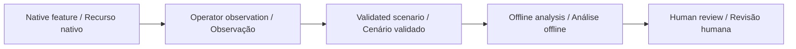

# Inclusive Encounter Kit · Kit de Encontro Inclusivo

[English](#english) · [Português](#português)

[](https://github.com/galafis/vbot-inclusive-encounter-kit/actions/workflows/checks.yml)

## English

Replay an optional robot encounter with separate participation and recording choices, pause/resume, withdrawal and a minimal public event journal.

**Status: working offline software prototype, synthetic examples, no physical validation.** Built specifically to investigate Vbot companion use within the capabilities the manufacturer permits. A standard unit without an open SDK is welcome.

### Try it

Node.js 22 or later. No packages, robot, account or API key required. After cloning, computation runs offline.

```sh
git clone https://github.com/galafis/vbot-inclusive-encounter-kit.git
cd vbot-inclusive-encounter-kit
npm test
npm run demo
npm run serve
```

Open `http://127.0.0.1:8765` for the English/Portuguese workbench. Edit the synthetic scenario, run the same engine used by the CLI and export the result. The server binds only to your own computer. Ctrl+C stops it. Use one workbench at a time on port 8765.

```sh
node cli.mjs examples/baseline.json new-result.json
```

Existing output files are refused. Exit 1 means invalid input or an I/O failure; exit 0 means analysis completed, including review findings. Do not infer suitability from the exit code.

### Implemented method

Finite state machine starts invited. Accept enters active; decline/withdraw ends. Pause disables recording; resume does not restore recording consent. Recording additionally requires an active session and a separate grant. Public export whitelists sequence/type/state/recording only; free text and identifiers are dropped.

### Worked example

Accept -> grant -> pause -> resume leaves the workflow active with recording off. A new independent grant is needed. Withdraw ends the session and later accept/grant events are rejected. The operator must verify the robot and app states separately.

### Vbot relationship and limits

A facilitator workflow using native app/operator controls only. The journal records software decisions, never proof that Vbot stopped moving or recording. No diagnosis or therapy.

We can use native features, the official app and manually recorded observations. SDK access is optional; no bypass, reverse engineering or unsupported modification is planned. [Permitted workflow](docs/VBOT_WORKFLOW.md).



## Português

Reproduza um encontro opcional com o robô, escolhas separadas de participação e gravação, pausa, retomada, retirada e diário público mínimo.

**Estado: protótipo funcional de software offline, exemplos fictícios, sem validação física.** Focado no estudo do Vbot conforme as capacidades permitidas pelo fabricante. Uma unidade comum sem SDK aberto é suficiente para iniciar.

### Experimentar

Execute os comandos acima com Node.js 22 ou superior. Não é necessário instalar dependências. Abra a bancada local e selecione Português. Edite o cenário, recalcule e exporte o resultado. Os testes e a linha de comando usam o mesmo motor da interface.

Fluxo do facilitador com controles nativos do aplicativo ou do operador. O diário não comprova parada física ou interrupção de gravação. Não é terapia.

Podemos trabalhar com funções nativas, aplicativo oficial e observações manuais. Acesso por SDK é opcional. Veja o [fluxo permitido](docs/VBOT_WORKFLOW.md) e a [validação](docs/VALIDATION.md). Os resultados demonstram comportamento do software; benefícios sociais e desempenho físico ainda precisam ser estudados.

## Documentation · Documentação

- [Input contract and method · Contrato e método](docs/METHOD.md)
- [Validation and reproducibility · Validação](docs/VALIDATION.md)
- [Vbot workflow · Fluxo Vbot](docs/VBOT_WORKFLOW.md)
- [Study plan · Plano de estudo](docs/STUDY_PLAN.md)
- [Synthetic input · Entrada fictícia](examples/baseline.json)
- [Expected output · Saída esperada](examples/expected.json)

Independent work by [Gabriel Demetrios Lafis](https://www.linkedin.com/in/gabriel-demetrios-lafis/) · [Existing robotics portfolio](https://github.com/galafis#robotics). Vbot is a third-party product/brand; this repository is not an official SDK or vendor endorsement.
